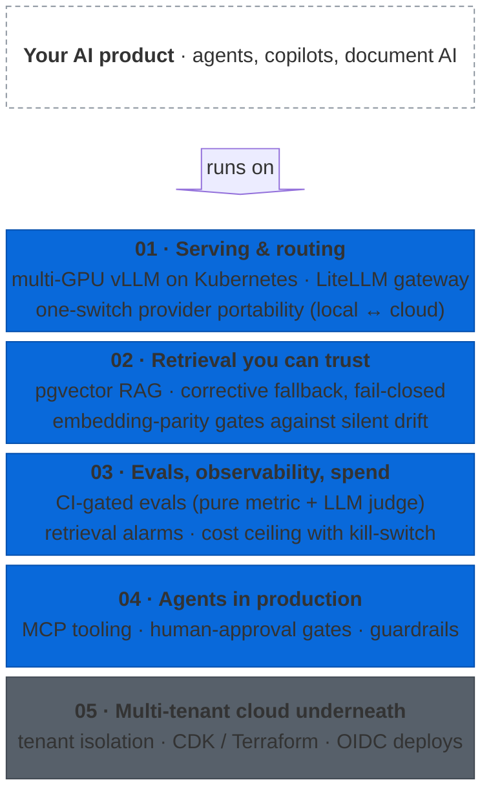

---

#### What I build

#### 16 years, same job at growing scale

| Years | Role | Proof |
|---|---|---|
| 2026 – now | Principal · multi-tenant AI SaaS | tenant isolation, AI spend ceilings, Document AI on AWS |
| 2024 – 2026 | Principal · GenAI infrastructure | multi-GPU vLLM on Kubernetes: **~25% lower cost, ~40% lower latency** · pipelines serving **80+ app vendors** |
| 2017 – 2024 | Senior · national digital-health platform | **100k+ users**, **99.5% uptime** · OAuth 2.0 SSO for 25,000+ users, SAML across 5+ partner orgs · zero-downtime AWS migration · deploys 4 h → 20 min |
| 2010 – 2017 | Engineer → Lead · ERP, school MIS, hospitality | led microservices architecture and sprint delivery · SOAP → REST modernization · engineering standards that cut production incidents **65%** |

#### Open work

| Repo | What it shows |
|---|---|
| [kattakath/skills](https://github.com/kattakath/skills) | Claude Code plugins and skills — agent tooling, guardrails, MCP |
| [kattakath/ircc-whatsapp-bot](https://github.com/kattakath/ircc-whatsapp-bot) | Corrective RAG (LangGraph + pgvector) answering only from official sources |
| [kattakath/nix-config](https://github.com/kattakath/nix-config) | Fleet infrastructure as code — CI gates, terranix, secrets, observability |
| [kattakath/.github](https://github.com/kattakath/.github) | Shared CI landing system — one required gate, merge queue, reusable workflows |

**Stack:** Python · TypeScript · FastAPI · Next.js · AWS · GCP · Kubernetes · vLLM · LiteLLM · pgvector · Terraform · Nix
